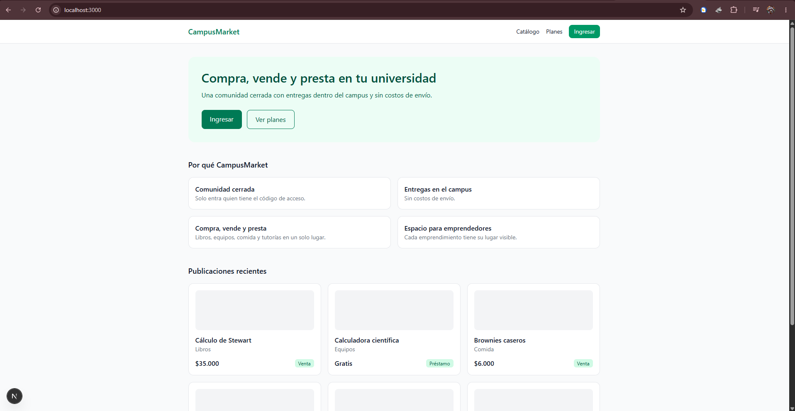
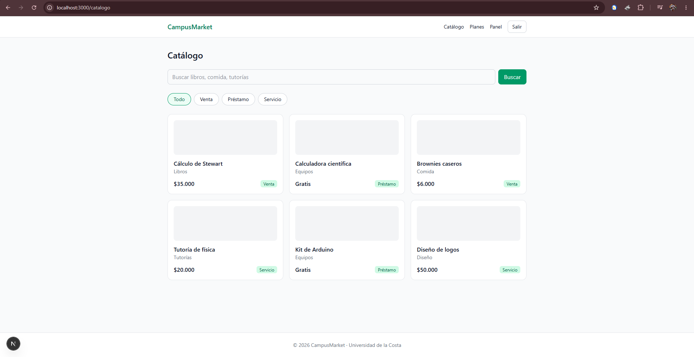
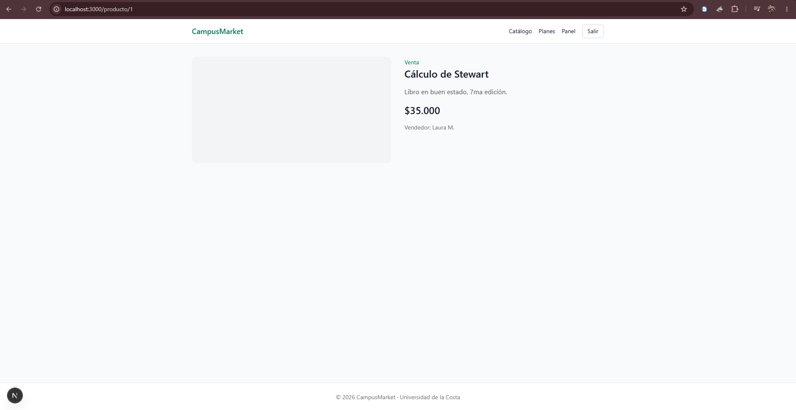
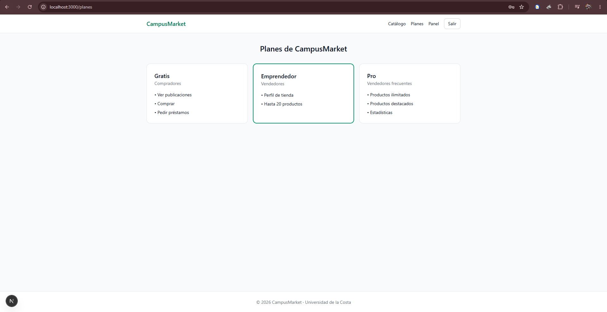
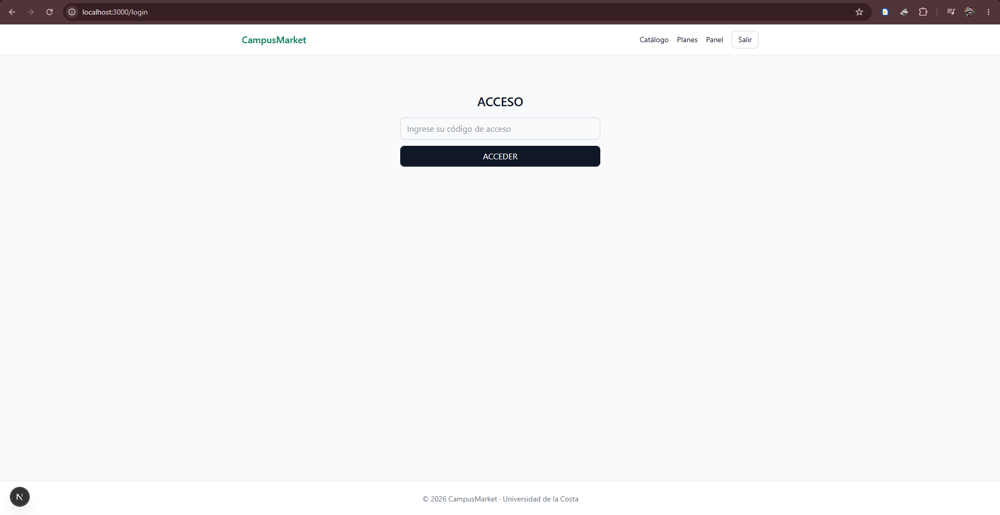
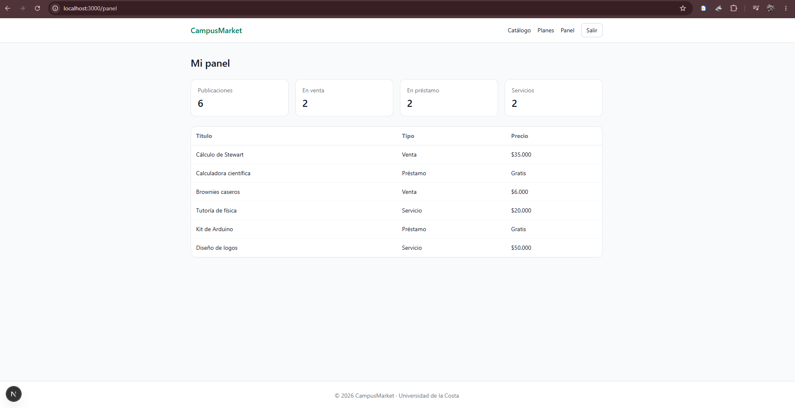

# CampusMarket

Plataforma SaaS de compraventa y préstamos para la comunidad universitaria.
Proyecto de Buenas Prácticas en el Desarrollo de Software, Universidad de la Costa (CUC).

**Aplicación en línea:** http://www.campusmarket.lat

## Capturas de pantalla 

| Inicio | Catálogo | Detalle |
|---|---|---|
|  |  |  |

| Planes | Acceso | Panel |
|---|---|---|
|  |  |  |

## Getting Started

Necesitas Node.js 20 o superior y Git.

```bash
git clone https://github.com/zwqui/campusmarket.git
cd campusmarket
npm install
cp .env.example .env.local
npm run dev
```

Abre http://localhost:3000. El código de acceso está en `.env.local` (variable `ACCESS_CODE`).

## Build

```bash
npm run lint
npm run build
npm run start
```

## Deploy

El despliegue es automático con GitHub Actions cuando se hace merge a `main` (archivo `.github/workflows/deploy.yml`):

1. **build**: instala dependencias, compila Next.js y crea `app.zip`.
2. **deploy**: sube `app.zip` a S3 y reemplaza los servidores EC2 por otros con la versión nueva.
3. **verify**: visita `/api/health` para confirmar que la app responde.

Secrets del repositorio: `AWS_ACCESS_KEY_ID`, `AWS_SECRET_ACCESS_KEY`, `AWS_SESSION_TOKEN`, `S3_BUCKET` y `APP_URL`.

## Arquitectura en AWS

Usuario → dominio propio (DNS) → Application Load Balancer → Auto Scaling Group con 2 servidores EC2 (us-east-1a y us-east-1b) que ejecutan Next.js. El bucket S3 guarda cada versión de la app. Detalle en [docs/ARQUITECTURA.md](docs/ARQUITECTURA.md).

## Flujo de la aplicación

1. El visitante ve la página de inicio, que es pública.
2. Para entrar al catálogo o al panel debe iniciar sesión con el código de acceso.
3. Con la sesión iniciada explora el catálogo, abre el detalle de una publicación y entra al panel.
4. Al cerrar sesión vuelve al inicio.

## Estructura del proyecto

```text
src/
├── app/
│   ├── layout.tsx       Estructura común de todas las páginas
│   ├── page.tsx         Página de inicio (pública)
│   ├── login/           Acceso con código
│   ├── catalogo/        Catálogo (privado)
│   ├── producto/[id]/   Detalle de una publicación (privado)
│   ├── panel/           Panel (privado)
│   ├── planes/          Planes de suscripción
│   └── api/health/      Endpoint para el balanceador
├── components/          Navbar, Footer, tarjetas, formulario
├── lib/                 Datos de prueba y formato de precios
└── proxy.ts             Protege las páginas privadas
```

## Recursos adicionales

- [Documentación de Next.js](https://nextjs.org/docs)
- [Conventional Commits](https://www.conventionalcommits.org/)
- [GitHub Actions](https://docs.github.com/actions)
- [Application Load Balancer](https://docs.aws.amazon.com/elasticloadbalancing/)
- [Amazon EC2 Auto Scaling](https://docs.aws.amazon.com/autoscaling/)

## Equipo

Tomás Valencia · Santiago Lozano · Ismeth Peñaloza · Aimer Ospino